> 来源：https://java.agentscope.io/v2/zh/intro.html  
> 版本：v2.0 | 更新：2026-07-10 | 维护方：Tongyi Lab, Alibaba Inc.

---

## 一、框架定位

AgentScope Java 2.0 是**面向企业级、分布式、生产环境**的智能体（Agent）框架，核心目标是提供与模型能力相匹配的工程底座，支持**长期、稳定、安全可控**的智能体任务执行。

---

## 二、核心设计理念

| 理念 | 说明 |
|------|------|
| **Agentic** | 智能体优先的执行模型 |
| **Harness** | 长期稳定运行的工程底座 |
| **Sandbox** | 隔离执行 + 快照恢复 |
| **Distributed** | A2A / MCP / 跨进程编排 |

---

## 三、核心组件全景

### 3.1 两大 Agent 类型

```
┌──────────────────────────────────────────────────────────────┐
│                        AgentScope Java                        │
├─────────────────────┬────────────────────────────────────────┤
│   ReActAgent（裸机） │       HarnessAgent（工程化）            │
│   解决"一次推理"    │  解决"长期稳定运行"                      │
│  推理→工具→回复      │  工作区+记忆+沙箱+子Agent+技能+计划模式  │
└─────────────────────┴────────────────────────────────────────┘
```

- **ReActAgent**：保留核心推理循环，适合快速尝试验证
- **HarnessAgent**：在 ReActAgent 基础上，通过 **Middleware** 与 **Toolkit** 扩展通道注入工程能力，二者共享同一推理核心，可无缝迁移

---

### 3.2 Building Blocks（核心构建块）

| 组件 | 职责 |
|------|------|
| **Agent** | 智能体核心抽象，封装推理循环 |
| **Message & Event** | 统一 ContentBlock 承载文本/文件/图片/思考/工具结果；类型化流式事件 |
| **Middleware** | 四个洋葱钩子（onAgent / onReasoning / onActing / onModelCall）+ onSystemPrompt 变换钩子 |
| **Model** | 统一 Credential + ChatModel 抽象，支持 Qwen / OpenAI / Anthropic / Gemini / DeepSeek / Ollama |
| **Permission System** | 权限三态决策（静态规则 + 工具类型 + 输入分析 → 允许 / 用户审批 / 拒绝） |
| **Tool** | 注解驱动注册，支持 MCP 统一接入 |
| **Context & AgentState** | 上下文压缩与状态管理，支持跨进程恢复 |

---

### 3.3 Harness 工程化层

Harness 是 AgentScope 2.0 的核心工程抽象，提供的关键能力：

```
┌─────────────────────────────────────────────────────────────┐
│                      HarnessAgent                            │
│                                                             │
│  ┌─────────────┐  ┌─────────────┐  ┌─────────────────────┐ │
│  │  Workspace   │  │   Memory    │  │     Sandbox         │ │
│  │  工作区抽象   │  │  上下文压缩  │  │  隔离执行+快照恢复   │ │
│  │  本地/Docker │  │  自动落盘    │  │  Docker/E2B云沙箱   │ │
│  │  /E2B云沙箱  │  │  大结果占位  │  │  预热池(RL训练)     │ │
│  └─────────────┘  └─────────────┘  └─────────────────────┘ │
│                                                             │
│  ┌─────────────┐  ┌─────────────┐  ┌─────────────────────┐ │
│  │  Subagent    │  │   Skill     │  │   Plan Mode         │ │
│  │  子Agent编排  │  │  四层合成    │  │  计划执行模式        │ │
│  │  Markdown声明 │  │  自学习闸门  │  │  声明式工作流        │ │
│  └─────────────┘  └─────────────┘  └─────────────────────┘ │
│                                                             │
│  ┌─────────────────────────────────────────────────────┐   │
│  │  Middleware Stack（洋葱钩子）                          │   │
│  │  onSystemPrompt → onAgent → onReasoning → onActing   │   │
│  │  → onModelCall                                        │   │
│  └─────────────────────────────────────────────────────┘   │
└─────────────────────────────────────────────────────────────┘
```

#### Harness 四大核心能力

1. **身份持续**：工作区即 Agent 的人格 + 长期记忆 + 领域知识，每轮自动注入
2. **上下文可控**：自动压缩、大工具结果落盘、ContextOverflow 兜底重试
3. **状态可恢复**：同 sessionId 跨进程恢复完整对话；沙箱状态可快照
4. **能力可沉淀**：四层 Skill 合成 + 自学习闸门；声明式子 Agent 编排

---

### 3.4 事件与权限系统

```
用户输入
    │
    ▼
┌─────────────────────────────────────────┐
│        统一消息结构 ContentBlock         │
│  文本 | 文件 | 图片 | 思考 | 工具结果     │
└──────────────────┬──────────────────────┘
                   │ streamEvents() 流式产生
                   ▼
┌─────────────────────────────────────────┐
│           类型化事件流                    │
│  模型调用 | 文本增量 | 工具调用            │
│  工具结果 | 用户确认                      │
└──────────────────┬──────────────────────┘
                   │
                   ▼
┌─────────────────────────────────────────┐
│        权限三态决策引擎                    │
│  静态规则 + 工具类型 + 输入分析           │
│  → 允许 / 用户审批 / 拒绝                 │
└─────────────────────────────────────────┘
```

---

### 3.5 模型层

- **支持厂商**：OpenAI（含兼容端点 vLLM、DeepSeek、Kimi、Moonshot）、Anthropic Claude、阿里云通义千问（DashScope）、Google Gemini、xAI Grok、本地 Ollama
- **容错机制**：可配置最大重试与备用模型，主模型不可用时自动切换

---

### 3.6 多智能体编排

```
Markdown 声明子Agent规格
         │
         ▼
   运行时按需调用
         │
    ┌────┴────┐
    ▼         ▼
agent_spawn  agent_send
    │         │
    ▼         ▼
后台任务 ──system-reminder反向推送──▶ 通知前端
（终态推送，无需轮询）
```

---

### 3.7 工具与 MCP

- 注解驱动的工具注册
- 按属性自动批处理（串行/并发）
- 统一接入任意 MCP 兼容服务器（文件系统、数据库、浏览器、代码解释器）
- `workspace/tools.json` 集中管理白名单

---

## 四、集成生态（Integration）

### 4.1 记忆存储（Memory）

| 方案 | 说明 |
|------|------|
| Mem0 | 第三方记忆服务 |
| 百炼记忆（Bailian） | 阿里云记忆服务 |
| ReMe | 本地记忆方案 |

### 4.2 Agent 状态存储（Session）

| 方案 | 说明 |
|------|------|
| JsonFileAgentStateStore | 默认本地存储 |
| MySQL State Store | 关系型持久化 |
| Redis State Store | 高性能分布式 |
| OSS State Store | 对象存储 |

### 4.3 RAG 知识库

支持：Simple、百炼知识库、Dify、HayStack、RAGFlow

### 4.4 技能仓库（Skill Repository）

支持：Git、MySQL、PostgreSQL 作为存储后端

### 4.5 智能体协议（Agent Protocols）

- **A2A**（Agent to Agent）：跨 Agent 通信协议
- **AG-UI**：UI 实时同步协议
- **Agent Protocol**：标准智能体协议

### 4.6 基础设施

| 组件 | 说明 |
|------|------|
| Higress | API 网关 |
| Nacos | 服务注册与配置 |
| Scheduler | 任务调度 |

### 4.7 生态扩展

- Chat Completions Web
- Studio（可视化调试）
- Online Training（在线训练）

---

## 五、生产级能力

### 5.1 水平扩展架构

```
                    ┌─────────────┐
                    │ Kubernetes  │
                    │    HPA      │
                    └──────┬──────┘
                           │
         ┌─────────────────┼─────────────────┐
         ▼                 ▼                 ▼
   ┌──────────┐     ┌──────────┐     ┌──────────┐
   │ Agent    │     │ Agent    │     │ Agent    │
   │ Instance │     │ Instance │     │ Instance │
   │  (副本1)  │     │  (副本2)  │     │  (副本N)  │
   └────┬─────┘     └────┬─────┘     └────┬─────┘
        │                 │                 │
        └─────────────────┼─────────────────┘
                          ▼
              ┌──────────────────────┐
              │  AgentStateStore      │
              │  (userId, sessionId)  │
              │  Redis / MySQL / OSS  │
              └──────────────────────┘
```

- **无状态水平扩展**：Agent 状态由 AgentStateStore 自动持久化，按 `(userId, sessionId)` 寻址
- **任意副本恢复**：同一用户的完整上下文可在任意副本恢复
- **工作区远端化**：可挂载到远端 KV / 对象存储
- **沙箱跨调用 resume**：可执行环境本身也可跨调用恢复

### 5.2 技术栈要求

- **JDK 17+**：使用 Records、Sealed Classes 等现代特性
- **响应式模型**：基于 Project Reactor 提供非阻塞执行
- **低冷启动**：可通过 Quarkus + GraalVM 原生镜像编译实现 100ms 内启动

---

## 六、快速上手路径

```
1. ReActAgent 起步
   └── 几分钟跑通核心推理循环

2. 按需叠加 Harness 能力
   └── 换 HarnessAgent，业务代码不动

3. 按需接入集成模块
   └── 记忆 / 存储 / RAG / 协议
```

---

## 七、框架架构总图（Mermaid）

```mermaid
graph TB
    subgraph "用户层"
        UI[前端 UI / Studio]
        API[API Gateway<br/>Higress]
        SK[技能仓库 Skill Repo]
    end

    subgraph "AgentScope Java 2.0 核心"
        subgraph "Building Blocks"
            AGENT[Agent 智能体]
            MSG[Message & Event<br/>类型化事件流]
            MID[Middleware Stack<br/>洋葱钩子链]
            MODEL[Model 模型层<br/>Qwen/OpenAI/Claude/Gemini...]
            PERM[Permission System<br/>权限三态决策]
            TOOL[Tool 系统<br/>注解驱动 + MCP]
            CTX[Context & AgentState<br/>上下文压缩 + 状态]
        end

        subgraph "Harness 工程化层"
            WS[Workspace 工作区<br/>本地/Docker/E2B云沙箱]
            MEM[Memory 记忆<br/>自动压缩 + 落盘]
            SB[Sandbox 沙箱<br/>隔离执行 + 快照恢复]
            SA[Subagent 子Agent<br/>声明式编排]
            SKILL[Skill 技能<br/>四层合成]
            PLAN[Plan Mode 计划模式<br/>声明式工作流]
        end
    end

    subgraph "集成生态"
        subgraph "存储"
            REDIS[Redis State Store]
            MYSQL[MySQL State Store]
            OSS[OSS State Store]
        end
        subgraph "记忆"
            MEM0[Mem0]
            BAILIAN[百炼记忆]
            REME[ReMe]
        end
        subgraph "RAG"
            DIFY[Dify]
            HAYSTACK[HayStack]
            RAGFLOW[RAGFlow]
        end
        subgraph "协议"
            A2A[A2A 协议]
            AGUI[AG-UI 协议]
            AP[Agent Protocol]
        end
        subgraph "基础设施"
            NACOS[Nacos]
            SCHED[Scheduler]
        end
    end

    subgraph "底层运行时"
        JVM[JDK 17+ / Project Reactor]
        K8S[Kubernetes + HPA]
        QUARKUS[Quarkus + GraalVM]
    end

    UI --> API
    API --> AGENT
    AGENT --> MSG
    AGENT --> MID
    AGENT --> MODEL
    AGENT --> PERM
    AGENT --> TOOL
    AGENT --> CTX

    AGENT --> WS
    AGENT --> MEM
    AGENT --> SB
    AGENT --> SA
    AGENT --> SKILL
    AGENT --> PLAN

    WS --> SB
    MEM --> REDIS
    MEM --> MYSQL
    MEM --> OSS
    MEM --> MEM0
    MEM --> BAILIAN
    MEM --> REME
    MEM --> DIFY
    MEM --> HAYSTACK
    MEM --> RAGFLOW

    SA --> A2A
    SA --> AGUI
    SA --> AP

    SK --> SKILL
    API --> NACOS
    API --> SCHED

    JVM --> K8S
    JVM --> QUARKUS
```



---

## 八、文档作用总结

本文档为 **AgentScope Java 2.0 框架的首页介绍**，从定位、核心组件、Harness 工程化能力、事件权限系统、多智能体编排、集成生态、生产级扩展路径八个维度，概览了框架全貌。文档重点突出了 **Harness** 作为长期稳定运行工程底座的核心价值，以及 **ReActAgent → HarnessAgent 的平滑演进路径**，是理解 AgentScope Java 2.0 整体架构的最佳入口。
